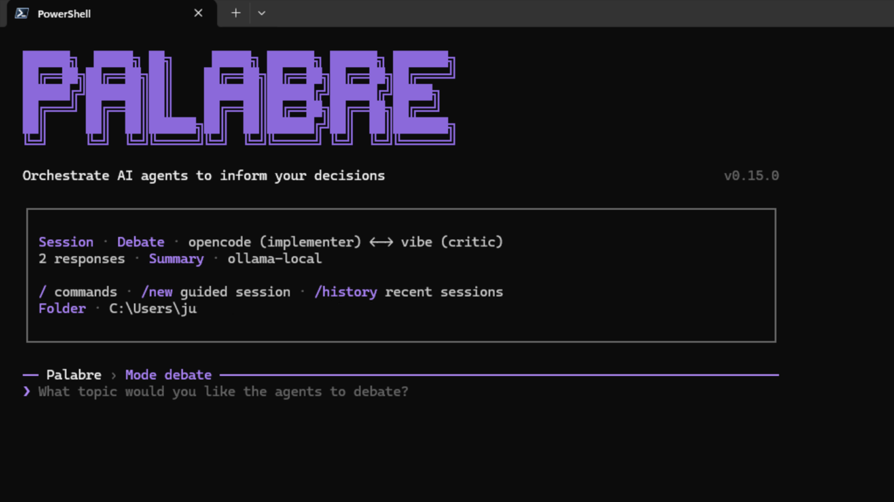

# PALABRE

<p>
  <a href="https://www.npmjs.com/package/palabre"></a>
  <a href="https://www.npmjs.com/package/palabre"></a>
  <a href="https://github.com/JuReyms/Palabre/blob/main/LICENSE"></a>
  <a href="https://palab.re"></a>
  <a href="https://marketplace.visualstudio.com/items?itemName=JuReyms.palabre-vscode"></a>
</p>



[English](#english) | [Français](#français)

## English

PALABRE lets the AI agents already installed on your machine work with you and with each other. It helps you **make better decisions before acting**, and orchestrates the exchanges between your agents.

**Compatible agents:** Claude Code, Codex CLI, Antigravity CLI, OpenCode, Mistral Vibe and Ollama (local).

**Privacy:** PALABRE CLI has no server. Your data only goes to the agents you choose. And with Ollama and a local model, nothing leaves your machine.

PALABRE does not replace your tools: it drives them. You keep your subscriptions, default models, terminal habits and local files.

**Several modes, depending on your need:** Debate, Relay, Ask and Chat, detailed below.

### Which mode for what?

| Mode | The question it answers | Example |
| --- | --- | --- |
| **Debate** | "I want two positions to confront each other." Two agents answer in turn, then a summary sets out agreements and disagreements. | `palabre codex-claude "Review this plan" -t 4` |
| **Relay** *(after 0.16.0)* | "I want my agents to hand off to each other autonomously, without any copy-paste from me." One agent directly notifies another agent (Claude Code or Codex): "I commented on issue #42, your turn", "Review this PR". | `palabre relay --from codex:<session> --to claude:<session> "I commented on issue #42, your turn"` |
| **Ask** | "I want several independent opinions." 1 to 4 agents answer without seeing each other's answers, then a summary compares them. | `palabre ask "Compare these two approaches" --agents codex claude` |
| **Chat** | "I'm chatting with an agent, and sometimes need a second opinion to double-check an answer." Ask another agent with `/consult`, without leaving the conversation. | `palabre chat --agent-a codex` |

In doubt: **Debate** for a decision with stakes, **Relay** to hand off to another agent, **Ask** for several opinions, **Chat** to talk with one agent.

### Installation

Requirements: Node.js 20 or newer, and at least one installed and authenticated agent. Two agents are needed for a Debate.

```bash
npm install -g palabre
# or: pnpm add --global palabre
# or: yarn global add palabre
# or: bun add --global palabre
palabre --version
```

### Quick start

```bash
palabre doctor   # checks your configuration and the agents found on your machine
palabre          # opens the interactive interface (TUI)
```

On first launch, the TUI creates the global configuration if needed and detects known agents. Useful commands in the TUI:

| Command | What it does |
| --- | --- |
| `/new` | Compose a session step by step. |
| `/chat`, `/ask` | Switch to Chat or Ask (Debate is the default mode). |
| `/consult <agent>` | In Chat, get a second opinion from another agent. |
| `/agents`, `/roles` | Choose the agents and their roles. |
| `/history` | See recent exports. |
| `/home` | Back to the home screen. |

`--terminal` forces the raw renderer for logs and scripts. `palabre init` remains available for an explicit setup, especially with `--local`.

### How it works

- **PALABRE drives your CLIs.** Each agent runs with its own tool, account and default model. PALABRE does not list models: `--model-a`, `--model-b` and `--summary-model` pass the raw value to the agent.
- **Context.** `--files` injects specific files (64 KiB per file, 192 KiB in total). `--context` scans folders with limits and exclusions. `--show-prompt` shows exactly what will be sent; `palabre context scan` previews the context.
- **Final summary.** At the end of an Ask or a Debate, a summary agent writes four sections: **Consensus**, **Disagreements / uncertainties**, **Proposed actions**, **Conclusion**. Choose it with `--summary-agent`, or turn it off with `--no-summary`.
- **Early stop.** A Debate (1 to 20 responses in total) can stop after a full round when an explicit agreement is detected. Turn it off with `--no-early-stop`.
- **Exports.** Each session is saved as Markdown (`.debate.md`, `.ask.md`, `.chat.md`). If an agent fails, a partial export is kept whenever possible.
- **Sessions.** `--checkpoint` makes a Debate or an Ask resumable with `palabre resume <session-id>`; `palabre sessions` lists or deletes checkpoints.

More examples:

```bash
palabre codex-claude "Review this architecture" --context src docs
palabre claude-ollama "Review this file" --files README.md
palabre codex-claude "Preview" --context src --show-prompt
palabre context scan src docs --json
palabre codex-claude "A resumable decision" --checkpoint
palabre sessions
```

### Roles

Each agent has a role. **A role changes the instruction sent to the agent, not the model.**

| Role | What the agent does |
| --- | --- |
| `implementer` | Proposes a concrete solution. |
| `reviewer` | Looks for risks, regressions and missing tests. |
| `critic` | Challenges assumptions. |
| `architect` | Structures the technical options. |
| `scout` | Explores a topic quickly. |
| `summarizer` | Writes a faithful summary. |

Combinations that work well:

- **`implementer` + `reviewer`**: one proposes, the other looks for what could break.
- **`architect` + `critic`**: lay out the options, then challenge them.
- **`scout`**: a quick first look before a deeper session.
- **`summarizer`**: for the final summary agent.

For one session: `--role-a`, `--role-b`, or `/roles` in the TUI. To change an agent's default role: `palabre agent-role <agent> <role>`.

### Compatible agents

| Agent | How PALABRE runs it |
| --- | --- |
| Claude Code | `claude --print` |
| Codex CLI | `codex exec` |
| Antigravity CLI | `agy --print`, in a pseudo-terminal |
| OpenCode | `opencode run` |
| Mistral Vibe | `vibe --output text --trust --prompt` |
| Ollama | local HTTP API: models run on your machine, without a subscription |

### Going further

- **VS Code extension.** [PALABRE for VS Code](https://marketplace.visualstudio.com/items?itemName=JuReyms.palabre-vscode) adds a sidebar to run Debate, Chat or Ask, attach workspace context, follow each session live and open its export. In Chat, you can switch the active agent or ask another agent for a one-off opinion. It stays a thin client: it launches the local `palabre` CLI and uses the public JSON/NDJSON contracts.
- **Integrations.** Versioned JSON outputs: `palabre agents --json`, `palabre presets --json`, `palabre context scan --json`, and `--renderer ndjson` or `--json` to follow a debate event by event. The NDJSON v1 stream is a public integration API: compatible additions do not break v1, breaking changes change the `v` field.
- **Skill for AI agents.** A ready-to-use skill teaches an AI agent when to use PALABRE and which mode to choose. It follows the open [agentskills.io](https://agentskills.io) standard. Copy the `skills/palabre` folder to `~/.claude/skills/` (Claude Code) or `~/.agents/skills/` (Codex), or run `hermes skills install JuReyms/Palabre/skills/palabre` (Hermes Agent). After a PALABRE update, copy the folder again. Details: [PALABRE skill](https://palab.re/en/get-started/skill).

### Documentation

[palab.re](https://palab.re) (mirror: [palabre.netlify.app](https://palabre.netlify.app)) — [Installation](https://palab.re/en/get-started/installation), [Configuration](https://palab.re/en/get-started/configuration), [First session](https://palab.re/en/get-started/first-debate), [CLI reference](https://palab.re/en/reference/cli), [Troubleshooting](https://palab.re/en/troubleshooting), [Roadmap](https://palab.re/en/roadmap).

### Privacy

PALABRE runs locally and does not send data to a PALABRE-owned server. Data sent to agents depends on the tools you use: check the privacy policies of Claude Code, Codex CLI, Antigravity CLI, OpenCode, Mistral Vibe, Ollama, or any custom agent you configure.

### Contributing / local development

```bash
git clone https://github.com/JuReyms/Palabre.git
cd PALABRE
pnpm install
pnpm build
pnpm link --global
palabre --version
```

Useful commands: `pnpm check`, `pnpm test`, `pnpm build`.

Before publishing, `pnpm smoke:real-presets -- --mode both --keep-going` runs real Debate and Ask sessions for the 10 active priority CLI pairs to validate the full agent → NDJSON → summary → export flow. This smoke test calls real AI CLIs and may consume quota, so it is not part of `pnpm test`.

Public roadmap: [docs/guide/fr/roadmap.md](./docs/guide/fr/roadmap.md). Changes: [CHANGELOG.md](./CHANGELOG.md). Agent/contributor guide: [AGENTS.md](./AGENTS.md).

### License

MIT. See [LICENSE](./LICENSE).


## Français

PALABRE fait travailler avec vous, et entre eux, les agents IA déjà installés sur votre machine. Il vous aide à **mieux décider avant d'agir**, et orchestre les échanges entre vos agents.

**Agents compatibles :** Claude Code, Codex CLI, Antigravity CLI, OpenCode, Mistral Vibe et Ollama (en local).

**Confidentialité :** PALABRE CLI n'a aucun serveur. Vos données ne vont qu'aux agents que vous choisissez. Et avec Ollama et un modèle local, rien ne quitte votre machine.

PALABRE ne remplace pas vos outils : il les pilote. Vous gardez vos abonnements, vos modèles par défaut, vos habitudes de terminal et vos fichiers en local.

**Plusieurs modes, selon votre besoin :** Débat, Relay, Ask et Chat, détaillés ci-dessous.

### Quel mode pour quoi ?

| Mode | La question à laquelle il répond | Exemple |
| --- | --- | --- |
| **Débat** | « Je veux confronter deux positions. » Deux agents répondent à tour de rôle, puis une synthèse dégage les accords et les désaccords. | `palabre codex-claude "Critique ce plan" -t 4` |
| **Relay** *(après la 0.16.0)* | « Je veux que mes agents se passent le relais de façon autonome, sans copier-coller de ma part. » Un agent prévient directement un autre agent (Claude Code ou Codex) : « J'ai commenté l'issue #42, à toi », « Relis cette PR ». | `palabre relay --from codex:<session> --to claude:<session> "J'ai commenté l'issue #42, à toi"` |
| **Ask** | « Je veux plusieurs avis indépendants. » De 1 à 4 agents répondent sans voir les réponses des autres, puis une synthèse les compare. | `palabre ask "Compare ces deux approches" --agents codex claude` |
| **Chat** | « Je discute avec un agent, et j'ai parfois besoin d'un second avis pour vérifier une réponse. » Consultez un autre agent avec `/consult`, sans quitter la conversation. | `palabre chat --agent-a codex` |

En cas de doute : **Débat** pour une décision qui compte, **Relay** pour passer la main à un autre agent, **Ask** pour plusieurs avis, **Chat** pour discuter avec un agent.

### Installation

Prérequis : Node.js 20 ou plus, et au moins un agent installé et authentifié. Deux agents sont nécessaires pour un Débat.

```bash
npm install -g palabre
# ou : pnpm add --global palabre
# ou : yarn global add palabre
# ou : bun add --global palabre
palabre --version
```

### Démarrage rapide

```bash
palabre doctor   # vérifie la configuration et les agents trouvés sur votre machine
palabre          # ouvre l'interface interactive (TUI)
```

Au premier lancement, la TUI crée la configuration globale si nécessaire et détecte les agents connus. Commandes utiles dans la TUI :

| Commande | Ce qu'elle fait |
| --- | --- |
| `/new` | Composer une session pas à pas. |
| `/chat`, `/ask` | Passer en Chat ou en Ask (le Débat est le mode par défaut). |
| `/consult <agent>` | En Chat, demander un second avis à un autre agent. |
| `/agents`, `/roles` | Choisir les agents et leurs rôles. |
| `/history` | Voir les derniers exports. |
| `/home` | Revenir à l'accueil. |

`--terminal` force le rendu brut pour les logs et les scripts. `palabre init` reste disponible pour un setup explicite, notamment avec `--local`.

### Comment ça fonctionne

- **PALABRE pilote vos CLI.** Chaque agent tourne avec son outil, son compte et son modèle par défaut. PALABRE ne liste pas les modèles : `--model-a`, `--model-b` et `--summary-model` transmettent la valeur brute à l'agent.
- **Contexte.** `--files` injecte des fichiers précis (64 Kio par fichier, 192 Kio au total). `--context` parcourt des dossiers avec des limites et des exclusions. `--show-prompt` montre exactement ce qui sera envoyé ; `palabre context scan` prévisualise le contexte.
- **Synthèse finale.** À la fin d'un Ask ou d'un Débat, un agent de synthèse rédige quatre sections : **Consensus**, **Désaccords / incertitudes**, **Actions proposées**, **Conclusion**. Choisissez-le avec `--summary-agent`, ou désactivez la synthèse avec `--no-summary`.
- **Arrêt anticipé.** Un Débat (1 à 20 réponses au total) peut s'arrêter après un tour complet quand un accord explicite est détecté. Désactivez-le avec `--no-early-stop`.
- **Exports.** Chaque session est enregistrée en Markdown (`.debate.md`, `.ask.md`, `.chat.md`). Si un agent échoue, un export partiel est conservé quand c'est possible.
- **Sessions.** `--checkpoint` rend un Débat ou un Ask reprenable avec `palabre resume <session-id>` ; `palabre sessions` liste ou supprime les points de reprise.

Plus d'exemples :

```bash
palabre codex-claude "Relis cette architecture" --context src docs
palabre claude-ollama "Critique ce fichier" --files README.md
palabre codex-claude "Preview" --context src --show-prompt
palabre context scan src docs --json
palabre codex-claude "Une décision reprenable" --checkpoint
palabre sessions
```

### Rôles

Chaque agent a un rôle. **Le rôle change la consigne envoyée à l'agent, pas le modèle.**

| Rôle | Ce que fait l'agent |
| --- | --- |
| `implementer` | Propose une solution concrète. |
| `reviewer` | Cherche les risques, les régressions et les tests manquants. |
| `critic` | Challenge les hypothèses. |
| `architect` | Structure les options techniques. |
| `scout` | Explore rapidement un sujet. |
| `summarizer` | Produit une synthèse fidèle. |

Des combinaisons qui marchent bien :

- **`implementer` + `reviewer`** : l'un propose, l'autre cherche ce qui pourrait casser.
- **`architect` + `critic`** : poser les options, puis les challenger.
- **`scout`** : un premier tour d'horizon rapide avant une session plus poussée.
- **`summarizer`** : pour l'agent de synthèse finale.

Pour une session : `--role-a`, `--role-b`, ou `/roles` dans la TUI. Pour changer le rôle par défaut d'un agent : `palabre agent-role <agent> <rôle>`.

### Agents compatibles

| Agent | Comment PALABRE le lance |
| --- | --- |
| Claude Code | `claude --print` |
| Codex CLI | `codex exec` |
| Antigravity CLI | `agy --print`, en pseudo-terminal |
| OpenCode | `opencode run` |
| Mistral Vibe | `vibe --output text --trust --prompt` |
| Ollama | API HTTP locale : les modèles tournent sur votre machine, sans abonnement |

### Pour aller plus loin

- **Extension VS Code.** [PALABRE pour VS Code](https://marketplace.visualstudio.com/items?itemName=JuReyms.palabre-vscode) ajoute une barre latérale pour lancer Débat, Chat ou Ask, ajouter du contexte de workspace, suivre chaque session en direct et ouvrir son export. En Chat, vous pouvez changer l'agent actif ou demander ponctuellement l'avis d'un autre agent. Elle reste un client mince : elle lance le CLI local `palabre` et utilise les contrats JSON/NDJSON publics.
- **Intégrations.** Sorties JSON versionnées : `palabre agents --json`, `palabre presets --json`, `palabre context scan --json`, et `--renderer ndjson` ou `--json` pour suivre un débat événement par événement. Le flux NDJSON v1 est une API publique d'intégration : les ajouts compatibles ne cassent pas v1, les changements cassants changent le champ `v`.
- **Skill pour agents IA.** Un skill prêt à l'emploi apprend à un agent IA quand utiliser PALABRE et quel mode choisir. Il suit le standard ouvert [agentskills.io](https://agentskills.io). Copiez le dossier `skills/palabre` dans `~/.claude/skills/` (Claude Code) ou `~/.agents/skills/` (Codex), ou lancez `hermes skills install JuReyms/Palabre/skills/palabre` (Hermes Agent). Après une mise à jour de PALABRE, recopiez le dossier. Détails : [Skill PALABRE](https://palab.re/fr/get-started/skill).

### Documentation

[palab.re](https://palab.re) (miroir : [palabre.netlify.app](https://palabre.netlify.app)) — [Installation](https://palab.re/fr/get-started/installation), [Configuration](https://palab.re/fr/get-started/configuration), [Première session](https://palab.re/fr/get-started/first-debate), [Référence CLI](https://palab.re/fr/reference/cli), [Dépannage](https://palab.re/fr/troubleshooting), [Roadmap](https://palab.re/fr/roadmap).

### Confidentialité

PALABRE tourne localement et n'envoie aucune donnée à un serveur appartenant à PALABRE. Les données envoyées aux agents dépendent des outils que vous utilisez : vérifiez les politiques de confidentialité de Claude Code, Codex CLI, Antigravity CLI, OpenCode, Mistral Vibe, Ollama ou de tout autre agent configuré.

### Contribution / développement local

```bash
git clone https://github.com/JuReyms/Palabre.git
cd PALABRE
pnpm install
pnpm build
pnpm link --global
palabre --version
```

Commandes utiles : `pnpm check`, `pnpm test`, `pnpm build`.

Avant une publication, `pnpm smoke:real-presets -- --mode both --keep-going` lance des sessions Débat et Ask réelles sur les 10 paires CLI prioritaires actives afin de vérifier le flux complet agent → NDJSON → synthèse → export. Ce smoke test appelle de vraies CLI IA et peut consommer des quotas ; il n'est donc pas lancé par `pnpm test`.

Roadmap publique : [docs/guide/fr/roadmap.md](./docs/guide/fr/roadmap.md). Changements : [CHANGELOG.md](./CHANGELOG.md). Guide agents/contributeurs : [AGENTS.md](./AGENTS.md).

### Licence

MIT. Voir [LICENSE](./LICENSE).
